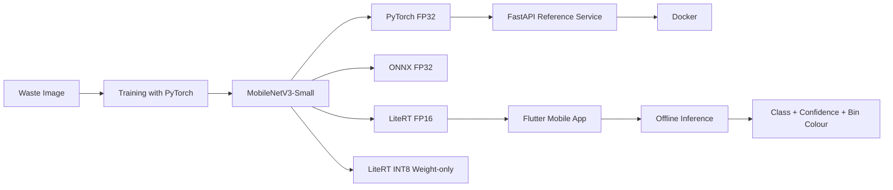

<div align="center">

# SmartWaste Vision

### An end-to-end Edge AI application for offline waste classification

A computer vision project that deploys the same image classifier across  
**PyTorch**, **ONNX Runtime**, and **LiteRT / TensorFlow Lite**, then integrates it into a fully offline Flutter application.

English · [Türkçe](README.md)


</div>

---

## Overview

SmartWaste Vision classifies one dominant waste object from a photo into one of six categories:

- Plastic
- Glass
- Metal
- Paper / cardboard
- Organic
- General waste

The project focuses not only on classification accuracy, but also on measuring how the same trained model changes across deployment environments in terms of **accuracy, Macro F1, model size, and latency**.

The mobile application performs inference entirely on-device. Images are not uploaded to a server.

---

## Mobile Application

| Home screen | Prediction result |
|---|---|
|  |  |

The application:

- Accepts images from the camera or gallery
- Runs inference directly on the Android device
- Displays the predicted class, confidence score, and top three probabilities
- Maps predictions to Turkish Zero Waste bin colours
- Avoids overconfident output when confidence is below `0.51`
- Can operate in airplane mode without network access

### Demo

[Watch the SmartWaste Vision mobile demo](docs/assets/smartwaste-vision-demo-tr.mp4)

---

## Results

Evaluation was performed on a fixed **598-image test split**.

| Runtime | Accuracy | Macro F1 | Model size | Mean / p95 CPU |
|---|---:|---:|---:|---:|
| PyTorch FP32 | **90.80%** | **0.9093** | 5.95 MiB | 5.24 / 6.17 ms |
| ONNX Runtime FP32 | **90.80%** | **0.9093** | 6.08 MiB | 1.35 / 1.79 ms |
| LiteRT FP16 | 90.64% | 0.9074 | 3.07 MiB | 6.80 / 8.11 ms |
| LiteRT INT8 weight-only | 89.80% | 0.8989 | **1.75 MiB** | **0.67 / 0.95 ms** |

CPU benchmarks were measured on an Intel i5-11400H under WSL2, with batch size 1 and four threads, excluding image decoding and preprocessing.

The FP16 model used by the Flutter application, including the actual Dart preprocessing pipeline, achieved:

- **Accuracy:** 90.47%
- **Macro F1:** 0.9056

Full-INT8 exports did not pass the quality gate and were not deployed. The INT8 weight-only model stores quantised weights but should not be interpreted as full-integer inference.


For the full benchmark protocol and measurement conditions, see:  
[CPU Benchmark Report](docs/benchmarks/02-cpu-baseline-results.md)

---

## System Architecture



---

## Technical Highlights

- ImageNet-pretrained `MobileNetV3-Small`
- Transfer learning with PyTorch
- Comparison of PyTorch, ONNX Runtime, and LiteRT
- FP16 and INT8 model-size experiments
- Desktop, server, and Android deployment from the same checkpoint
- Dart preprocessing validated against the training pipeline
- Fully offline inference in Flutter
- Abstention flow for low-confidence predictions
- Dockerised PyTorch / FastAPI reference service
- Model Card, Dataset Card, and architecture decisions
- Reproducible benchmark and export validation workflow

---

## Technology Stack

### Model and evaluation

- Python
- PyTorch
- Torchvision
- ONNX Runtime
- TensorFlow Lite / LiteRT
- NumPy
- scikit-learn

### Mobile

- Flutter
- Dart
- Camera and gallery integration
- On-device LiteRT inference

### Service and deployment

- FastAPI
- Docker
- Multipart image upload
- Health-check and inference endpoints

---

## Quick Start

### Flutter application

```powershell
cd apps/mobile
flutter pub get
flutter test
cd ../..
.\scripts\build_android.ps1 -Configuration Debug
.\scripts\build_android.ps1 -Configuration Release
```

The release-mode test APK is written to:

```text
artifacts/mobile/smartwaste-vision-release.apk
```

This APK is signed with a debug key for testing and is not a Play Store distribution package.

### Docker reference API

```bash
docker build -t smartwaste-vision-api .
docker run --rm -p 8000:8000 smartwaste-vision-api
curl -F "file=@waste.jpg;type=image/jpeg" http://localhost:8000/v1/classify
```

The mobile application does not use the API for inference. The FastAPI service is kept separately to demonstrate server-side deployment of the same FP32 checkpoint.

---

## Repository Structure

```text
SmartWaste-Vision/
├── api/                  # FastAPI reference service
├── apps/mobile/          # Flutter mobile application
├── docs/                 # Model, dataset, benchmark, and decision documents
├── scripts/              # Training, export, evaluation, and build scripts
├── artifacts/            # Test and build outputs
├── PROJECT_PLAN.md
├── README.md
└── README.en.md
```

---

## Documentation

- [Model Card — Turkish](docs/model/MODEL_CARD.md)
- [Model Card — English](docs/model/MODEL_CARD.en.md)
- [Dataset Card — Turkish](docs/data/DATASET_CARD.md)
- [Dataset Card — English](docs/data/DATASET_CARD.en.md)
- [Baseline and export results](docs/model/01-baseline-results.md)
- [CPU benchmark report](docs/benchmarks/02-cpu-baseline-results.md)
- [Flutter MVP and preprocessing validation](docs/mobile/01-flutter-mvp.md)
- [INT8 deployment decision](docs/decisions/ADR-002-int8-deployment-policy.md)
- [FastAPI service](api/README.md)
- [Implementation plan](PROJECT_PLAN.md)

---

## Scope and Limitations

SmartWaste Vision:

- Is designed for one clear, dominant object in a photo
- Does not perform object detection, segmentation, or multi-object separation
- Is not a professional decision system for hazardous, medical, or electronic waste
- Does not provide municipality-specific disposal instructions
- Uses training data collected from a single Australian facility
- Shows weaker performance on the plastic class
- Still requires independent field evaluation with phone-captured images
- Still requires final latency and RAM measurements on a physical Android device

### Dataset licence note

RealWaste licence records conflict. UCI metadata lists CC BY 4.0, while the downloaded dataset and owner README files state CC BY-NC-SA 4.0.

This project conservatively follows the more restrictive interpretation. Public or commercial distribution of model weights requires a separate review.

See the [Dataset Card](docs/data/DATASET_CARD.en.md) for details.

---

## Project Goal

This project demonstrates an image classifier that is not left inside a notebook. It covers training, export, benchmarking, mobile integration, and reference API deployment as a complete **end-to-end Edge AI product**.
