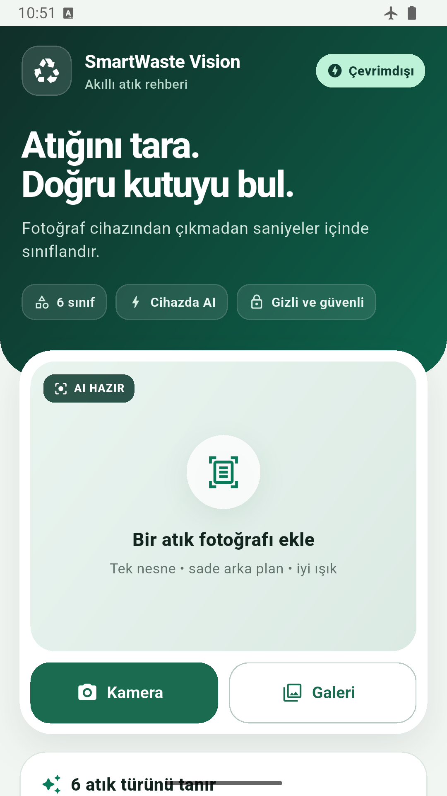
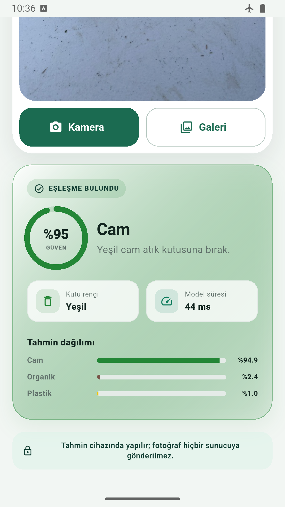
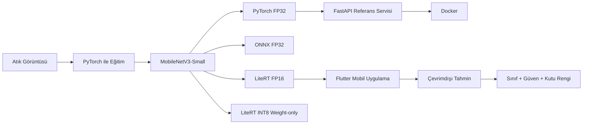

<div align="center">

# SmartWaste Vision

### Çevrimdışı atık sınıflandırması için uçtan uca Edge AI uygulaması

Aynı görüntü sınıflandırma modelini **PyTorch**, **ONNX Runtime** ve  
**LiteRT / TensorFlow Lite** ortamlarında karşılaştıran; Flutter tabanlı mobil uygulamada tamamen çevrimdışı çalışan bir bilgisayarlı görü projesi.

[English](README.en.md) · Türkçe


</div>

---

## Proje Özeti

SmartWaste Vision, tek bir fotoğraftaki baskın atık nesnesini altı sınıftan birine ayırır:

- Plastik
- Cam
- Metal
- Kâğıt / karton
- Organik
- Genel atık

Projenin ana amacı yalnızca yüksek doğruluk elde etmek değil; aynı eğitilmiş modelin farklı çalışma ortamlarındaki **doğruluk, Macro F1, model boyutu ve gecikme** değişimlerini ölçmek ve bu modeli gerçek bir mobil kullanıcı akışına dönüştürmektir.

Mobil uygulama tahmin için internete ihtiyaç duymaz. Fotoğraflar cihazdan dışarı gönderilmez.

---

## Mobil Uygulama

| Ana ekran | Tahmin sonucu |
|---|---|
|  |  |

Uygulama:

- Kamera ve galeriden görüntü alır
- Tahmini cihaz üzerinde çalıştırır
- Sınıf, güven skoru ve en yüksek üç olasılığı gösterir
- Sonucu Türkiye Sıfır Atık kutu renkleriyle eşleştirir
- Güven skoru `0.51` altında olduğunda kesin tahmin vermek yerine kullanıcıyı uyarır
- Uçak modunda ve ağ bağlantısı olmadan çalışabilir

### Demo

[SmartWaste Vision mobil demo videosunu izle](docs/assets/smartwaste-vision-demo-tr.mp4)

---

## Sonuçlar

Değerlendirme, sabitlenmiş **598 görüntülük test bölümü** üzerinde gerçekleştirilmiştir.

| Runtime | Accuracy | Macro F1 | Model boyutu | Ortalama / p95 CPU |
|---|---:|---:|---:|---:|
| PyTorch FP32 | **%90,80** | **0,9093** | 5,95 MiB | 5,24 / 6,17 ms |
| ONNX Runtime FP32 | **%90,80** | **0,9093** | 6,08 MiB | 1,35 / 1,79 ms |
| LiteRT FP16 | %90,64 | 0,9074 | 3,07 MiB | 6,80 / 8,11 ms |
| LiteRT INT8 weight-only | %89,80 | 0,8989 | **1,75 MiB** | **0,67 / 0,95 ms** |

CPU benchmarkları Intel i5-11400H üzerinde WSL2, batch size 1 ve dört thread ile; görüntü decode ve ön işleme süreleri hariç ölçülmüştür.

Flutter uygulamasında gerçek Dart ön işleme zinciriyle kullanılan FP16 model:

- **Accuracy:** %90,47
- **Macro F1:** 0,9056

Full INT8 dönüşümleri kalite eşiğini geçmediği için mobil dağıtıma alınmamıştır. INT8 weight-only model yalnızca ağırlıkları küçültür; tam tamsayı çıkarımı olarak sunulmamaktadır.


Ayrıntılı benchmark protokolü ve ölçüm koşulları için:  
[CPU Benchmark Raporu](docs/benchmarks/02-cpu-baseline-results.md)

---

## Sistem Mimarisi



---

## Teknik Öne Çıkanlar

- ImageNet ön eğitimli `MobileNetV3-Small`
- PyTorch ile transfer learning
- PyTorch, ONNX Runtime ve LiteRT karşılaştırması
- FP16 ve INT8 model küçültme deneyleri
- Aynı checkpoint için masaüstü, sunucu ve Android dağıtımı
- Pillow ile uyumlu Dart ön işleme doğrulaması
- Flutter üzerinde tamamen çevrimdışı çıkarım
- Düşük güven durumları için abstention akışı
- Docker içinde çalışan PyTorch / FastAPI referans servisi
- Model Card, Dataset Card ve karar kayıtları
- Tekrarlanabilir benchmark ve export doğrulama süreci

---

## Kullanılan Teknolojiler

### Model ve değerlendirme

- Python
- PyTorch
- Torchvision
- ONNX Runtime
- TensorFlow Lite / LiteRT
- NumPy
- scikit-learn

### Mobil

- Flutter
- Dart
- Kamera / galeri entegrasyonu
- Cihaz içi LiteRT çıkarımı

### Servis ve dağıtım

- FastAPI
- Docker
- Multipart image upload
- Health-check ve inference endpointleri

---

## Hızlı Başlangıç

### Flutter uygulaması

```powershell
cd apps/mobile
flutter pub get
flutter test
cd ../..
.\scripts\build_android.ps1 -Configuration Debug
.\scripts\build_android.ps1 -Configuration Release
```

Release-mode test APK şu konuma yazılır:

```text
artifacts/mobile/smartwaste-vision-release.apk
```

Bu APK test amacıyla debug anahtarıyla imzalanır; Play Store dağıtım paketi değildir.

### Docker referans API

```bash
docker build -t smartwaste-vision-api .
docker run --rm -p 8000:8000 smartwaste-vision-api
curl -F "file=@waste.jpg;type=image/jpeg" http://localhost:8000/v1/classify
```

Mobil uygulama tahmin için API kullanmaz. FastAPI servisi, aynı FP32 checkpoint'in sunucu tarafındaki referans dağıtımını göstermek için ayrı tutulmuştur.

---

## Proje Yapısı

```text
SmartWaste-Vision/
├── api/                  # FastAPI referans servisi
├── apps/mobile/          # Flutter mobil uygulaması
├── docs/                 # Model, veri, benchmark ve karar belgeleri
├── scripts/              # Eğitim, export, değerlendirme ve build betikleri
├── artifacts/            # Test ve build çıktıları
├── PROJECT_PLAN.md
├── README.md
└── README.en.md
```

---

## Dokümantasyon

- [Model Card — Türkçe](docs/model/MODEL_CARD.md)
- [Model Card — English](docs/model/MODEL_CARD.en.md)
- [Dataset Card — Türkçe](docs/data/DATASET_CARD.md)
- [Dataset Card — English](docs/data/DATASET_CARD.en.md)
- [Baseline ve export sonuçları](docs/model/01-baseline-results.md)
- [CPU benchmark raporu](docs/benchmarks/02-cpu-baseline-results.md)
- [Flutter MVP ve ön işleme doğrulaması](docs/mobile/01-flutter-mvp.md)
- [INT8 dağıtım kararı](docs/decisions/ADR-002-int8-deployment-policy.md)
- [FastAPI servisi](api/README.md)
- [Uygulama planı](PROJECT_PLAN.md)

---

## Kapsam ve Sınırlılıklar

SmartWaste Vision:

- Tek fotoğraftaki tek baskın nesneyi sınıflandırmak için tasarlanmıştır
- Nesne tespiti, segmentasyon veya çoklu atık ayrımı yapmaz
- Tehlikeli, tıbbi veya elektronik atıklar için profesyonel karar sistemi değildir
- Belediye bazlı kesin bertaraf talimatı vermez
- Eğitim verisi tek bir Avustralya tesisinden gelmektedir
- Plastik sınıfı diğer sınıflara göre daha zayıf performans göstermektedir
- Bağımsız telefon fotoğraflarıyla saha değerlendirmesi hâlâ gereklidir
- Fiziksel Android cihaz üzerinde gecikme ve RAM ölçümü tamamlanması gereken son doğrulama adımıdır

### Veri lisansı notu

RealWaste lisans kayıtları birbiriyle çelişmektedir. UCI metadata sayfası CC BY 4.0 belirtirken indirilen veri ve proje sahibi README dosyaları CC BY-NC-SA 4.0 bilgisini içermektedir.

Bu proje ihtiyatlı olarak daha kısıtlayıcı lisans koşullarını esas alır. Model ağırlıklarının kamusal veya ticari dağıtımı ayrıca incelenmelidir.

Ayrıntılar için: [Dataset Card](docs/data/DATASET_CARD.md)

---

## Projenin Amacı

Bu çalışma, bir görüntü sınıflandırma modelinin yalnızca notebook ortamında bırakılmadığı; eğitimden export sürecine, benchmarklardan mobil entegrasyona ve referans API dağıtımına kadar tamamlanan bir **uçtan uca Edge AI ürünü** sunmayı amaçlamaktadır.
