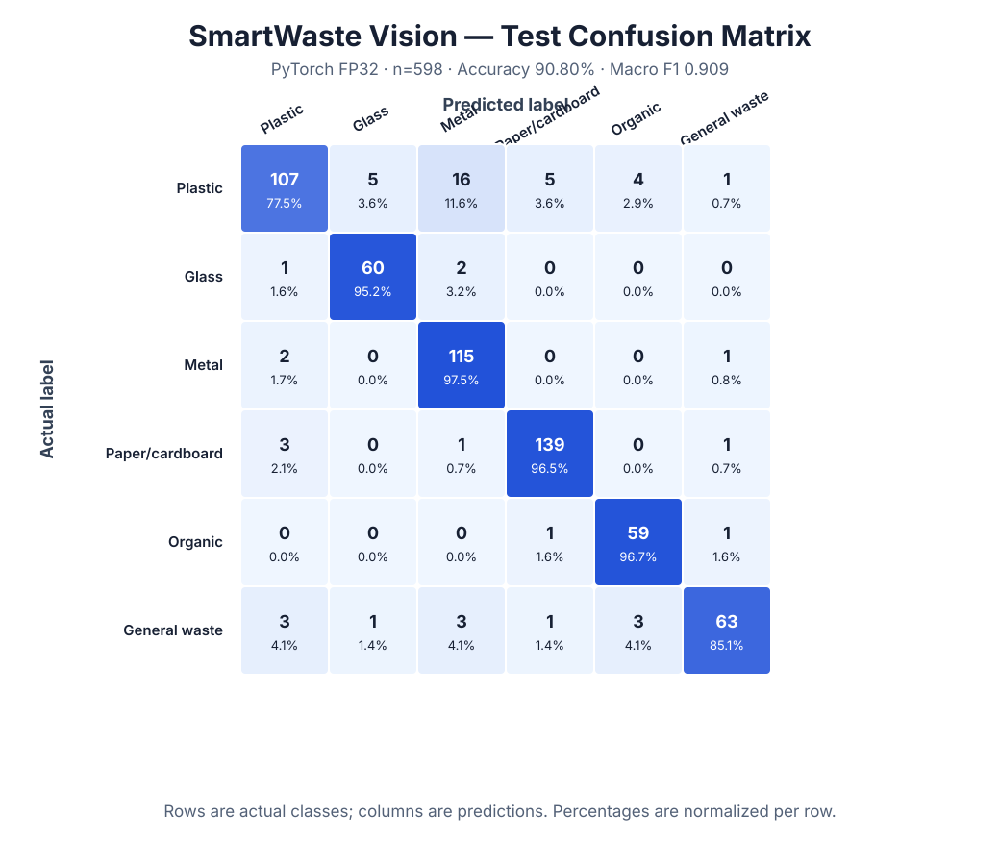

# MobileNetV3-Small — FP32 Baseline Sonucu

## Eğitim özeti

- Tarih: 3 Ağustos 2026
- Model: ImageNet ağırlıklı `MobileNetV3-Small`
- Hedef: 6 sınıf
- Veri: 2.800 train / 600 validation / 598 test
- Donanım: NVIDIA GeForce RTX 3050 Ti Laptop GPU, 4 GB
- Batch: 32
- Epoch: 12
- İlk 2 epoch: yalnız classifier warmup
- Sonraki 10 epoch: backbone `1e-4`, classifier `2e-4` ile fine-tune
- Loss: class-weighted cross entropy, label smoothing `0,1`
- Model seçimi: validation Macro F1
- En iyi checkpoint: epoch 11
- Ölçülen train+validation süresi: yaklaşık 403 saniye

## En iyi validation sonucu

| Ölçüt | Sonuç |
|---|---:|
| Accuracy | %91,17 |
| Macro F1 | 0,9146 |

Test split'i model seçimi için kullanılmadı.

## Dondurulmuş test sonucu

CPU üzerinde yeniden değerlendirilen PyTorch checkpoint sonucu:

| Ölçüt | Sonuç |
|---|---:|
| Accuracy | %90,80 |
| Macro F1 | 0,9093 |
| Macro precision | 0,9088 |
| Macro recall | 0,9138 |

GPU eğitim raporundaki Accuracy `%90,64`, Macro F1 `0,9076` idi. CPU ve GPU
arasındaki bir örneklik sınır farkı, yakın logits üzerindeki nümerik yürütme
farkından kaynaklanmaktadır; export karşılaştırmaları aynı CPU referansını
kullanır.

## Sınıf bazlı gözlem

- En güçlü sınıf `paper_cardboard`: F1 yaklaşık `0,959`.
- `glass` ve `organic`: F1 yaklaşık `0,93`.
- En zayıf sınıf `plastic`: F1 yaklaşık `0,84`; plastik örneklerinin önemli bir
  bölümü `metal` ile karışıyor.
- `general_waste`: F1 yaklaşık `0,89`; sınıfın görsel çeşitliliği nedeniyle hata
  analizi ve confidence threshold çalışması gerektiriyor.

## Export doğruluğu — 598 test görüntüsü

| Model | Accuracy | Macro F1 | PyTorch top-1 agreement | Karar |
|---|---:|---:|---:|---|
| PyTorch FP32 | %90,80 | 0,9093 | %100 | Referans |
| ONNX FP32 | %90,80 | 0,9093 | %100 | Kabul |
| LiteRT FP16 | %90,64 | 0,9074 | %99,83 | Kabul |
| LiteRT FP16 + gerçek Dart mobil ön işleme | %90,47 | 0,9056 | — | Flutter adayı |
| LiteRT INT8 weight-only | %89,80 | 0,8989 | %97,66 | Kabul, float compute |
| ONNX full INT8 PTQ | %24,08 | 0,0823 | %24,58 | Red |
| LiteRT full INT8 PTQ | %10,54 | 0,0318 | %11,04 | Red |

INT8 weight-only artifactı ağırlıkları `int8` saklar fakat giriş, çıkış ve
hesaplama float olarak kalır. Bu nedenle “tam integer” diye sunulmaz.

## QAT deneyi

PT2E QAT graph'ı başarıyla hazırlandı ve GPU'da eğitildi. Üç epoch sonunda en
iyi validation Macro F1 `0,575` olduğu için QAT state reddedildi. Tam INT8
artifactları uygulamaya alınmayacak; kabul edilen mobil adaylar FP16 ve INT8
weight-only modelleridir.
